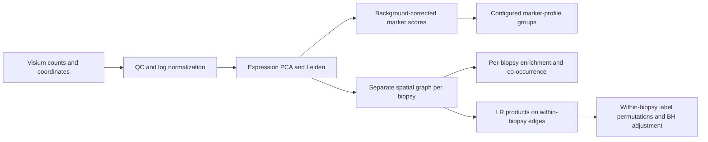

# Spatial Kidney Rejection — Exploratory Visium Analysis

A reproducible notebook workflow for four kidney allograft biopsies from [GSE304669](https://www.ncbi.nlm.nih.gov/geo/query/acc.cgi?acc=GSE304669): one control and one biopsy each with active AMR, acute TCMR, and chronic active AMR.

The workflow combines expression clustering, marker scores, within-biopsy spatial neighborhoods, and exploratory ligand–receptor (LR) gene-pair associations. It does **not** estimate validated cell proportions, demonstrate signaling activity, or test rejection effects across patients. The single control biopsy cannot establish control-population variability.

## Analysis status

The implementation was corrected after a code and statistical review. Earlier tables, images, and the original overview diagram are retained in [results/legacy_20260724](results/legacy_20260724) as **superseded outputs**. They must not be mixed with outputs from the corrected notebooks.

Every new run records its configuration, package versions, code revision, and completion checkpoints in a separate run directory. See [the correction record](docs/corrections.md) for the changes and validation status.

## Workflow



| Notebook | Outputs |
|---|---|
| [01_data_loading_qc](notebooks/01_data_loading_qc.ipynb) | Counts and lognorm layers, QC summaries, unique sample/barcode identifiers |
| [02_spatial_clustering](notebooks/02_spatial_clustering.ipynb) | Expression-only PCA/Leiden/UMAP, marker candidates, spatial graphs |
| [03_marker_scoring](notebooks/03_marker_scoring.ipynb) | Marker scores and descriptive summaries per biopsy |
| [04_spatial_niche_analysis](notebooks/04_spatial_niche_analysis.ipynb) | Marker-profile groups, separate neighborhood/co-occurrence results for each biopsy |
| [05_ligand_receptor](notebooks/05_ligand_receptor.ipynb) | All spatial LR tests, BH-adjusted screening table, per-biopsy descriptive scores |

Notebook 04 retains its earlier filename for continuity; it does not claim to discover validated anatomical niches. The old Cell2location notebook was replaced with explicit marker scoring. Reference-based deconvolution is not supported; selecting that method raises a clear error before training.

## Run from a fresh checkout

Python 3.12 is the tested version. The full verified environment includes transitive dependencies; `requirements.txt` lists the main pinned dependencies.

```bash
git clone https://github.com/xqiu625/spatial-kidney-rejection.git
cd spatial-kidney-rejection
python3.12 -m venv .venv
source .venv/bin/activate
python -m pip install -r requirements-lock.txt
```

Alternatively, `mamba env create -f environment.yml` installs the main pinned dependencies through pip inside a Python 3.12 environment.

Download **GSE304669_RAW.tar** from the supplementary files on the [GEO accession page](https://www.ncbi.nlm.nih.gov/geo/query/acc.cgi?acc=GSE304669). Save it as `data/GSE304669_RAW.tar`. This public archive contains the sample-prefixed compressed matrices, positions and images used by the loader.

```bash
python -m src.prepare_data --archive data/GSE304669_RAW.tar --output data/raw
python -m src.run_notebooks --run-dir runs/analysis-01
```

Data preparation validates expected archive members, refuses to replace an existing nonempty destination, and writes the archive SHA-256 to `data/raw/source.json`. The expected layout is:

```text
data/raw/GSM9155022_control_58055/
  filtered_feature_bc_matrix/{matrix.mtx,features.tsv,barcodes.tsv}
  spatial/{tissue_positions.csv,scalefactors_json.json,tissue_hires_image.png,tissue_lowres_image.png}
```

The same structure is required for the other three samples listed in [paths.yaml](config/paths.yaml). Compressed matrix/feature/barcode files and older `tissue_positions_list.csv` are also supported by the loader. Missing samples or unmatched matrix barcodes fail explicitly.

Parameters come from [analysis_params.yaml](config/analysis_params.yaml). `SKR_DATA_DIR` overrides `base_dir`, so the default raw path becomes `$SKR_DATA_DIR/data/raw`. `--run-dir` (or `SKR_RUN_DIR` when running notebooks manually) sets the output directory. Use a **new directory for every complete run**. The workflow refuses to reuse completed checkpoints or mix changed parameters into an existing run.

Executed notebooks and H5AD checkpoints remain under the chosen run directory; source notebooks are kept free of stale execution output. `run.json` records the settings and versions used. For interactive execution, select the same virtual environment's Python kernel, set `SKR_RUN_DIR` before notebook 01, and run 01–05 in order.

## What the calculations mean

**Expression.** Counts are preserved in `layers['counts']`; library-size normalization to 10,000 followed by log1p is preserved in `layers['lognorm']`. Scaling is applied only to a temporary HVG matrix for PCA. Marker-gene testing and LR analysis explicitly read lognorm, regardless of the state of `X`.

**Marker scores and profiles.** Scanpy scores the existing 14 marker sets using matched background genes, where at least two markers are present. These are signed relative expression scores, not fractions or cell counts. KMeans uses a configured number of groups (default six) on these scores. Profile frequencies describe spot groups within each biopsy; biological names require independent marker and histological validation.

**Spatial neighborhoods.** Squidpy constructs a graph separately for each sample; the stored graph is symmetric and has no self edges. A validation step rejects cross-sample edges. Neighborhood label permutations and coordinate-based co-occurrence are computed on individual biopsies. Co-occurrence distances are image pixels, not automatically calibrated microns. Undefined Z-scores remain missing; no disease-level significance is inferred from them.

**LR screening.** For sample s, ordered clusters a/b and candidate genes L/R, let E(s,a,b) be directed graph edges from a spot in a to a spot in b. The score is the mean of `lognorm[i,L] * lognorm[j,R]` over these edges. An empty edge set has score zero. The curated list contains 48 gene-pair candidates; only pairs whose two genes exist in the input are tested. It does not model full receptor complexes.

Cluster labels are shuffled within each biopsy while expression and edges remain fixed. The one-sided Monte Carlo p-value is `(1 + count(null_score >= observed_score)) / (B + 1)`. The default is 999 permutations. BH adjustment covers **all sample × present-cluster × present-cluster × available-LR combinations in the run**, including zero-edge combinations (p=1). Both the full table and the FDR-filtered table are saved; plots use the latter.

This null assumes label exchangeability within a biopsy. Clusters were learned from expression, and spatial autocorrelation is not preserved by unconstrained label shuffling. Accordingly, these are **exploratory label-association scores and adjusted screening statistics**, not calibrated evidence of physical communication, causal signaling, or clinical disease effects. The permutation count also limits p-value resolution.

**Condition summaries.** Tables retain sample ID and rejection subtype. There are no spot-level Mann–Whitney/chi-square disease tests, pooled disease p-values, or claims that thousands of spots create biological replication. More independent biopsies would be needed for patient-level comparisons.

## Tests

```bash
python -m pytest -q
python tests/smoke_notebooks.py
```

The regression checks cover expression-layer preservation, finite marker fold changes, spatial score dependence, depth-only changes, sample isolation, full-family BH adjustment, disabled reference inference, config/checkpoint protection, data loading, and plotting. The smoke test builds a small synthetic Visium archive and executes all five actual notebooks. GitHub Actions runs both checks.

## Data and software

- Data: [GSE304669](https://www.ncbi.nlm.nih.gov/geo/query/acc.cgi?acc=GSE304669), human kidney transplant Visium biopsies.
- Related study: [Frontiers in Immunology (2025)](https://www.frontiersin.org/journals/immunology/articles/10.3389/fimmu.2025.1654741/full).
- Software: Scanpy, Squidpy, AnnData, NumPy/SciPy, scikit-learn, pandas and Matplotlib.
- [MIT license](LICENSE). Analysis by Xinru Qiu.
